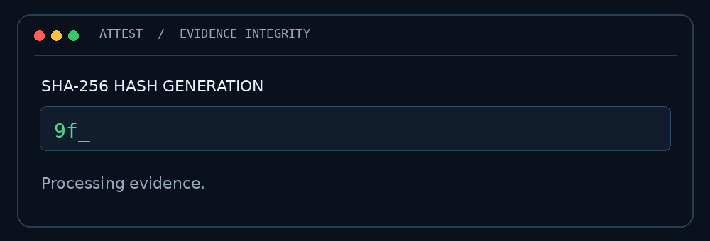
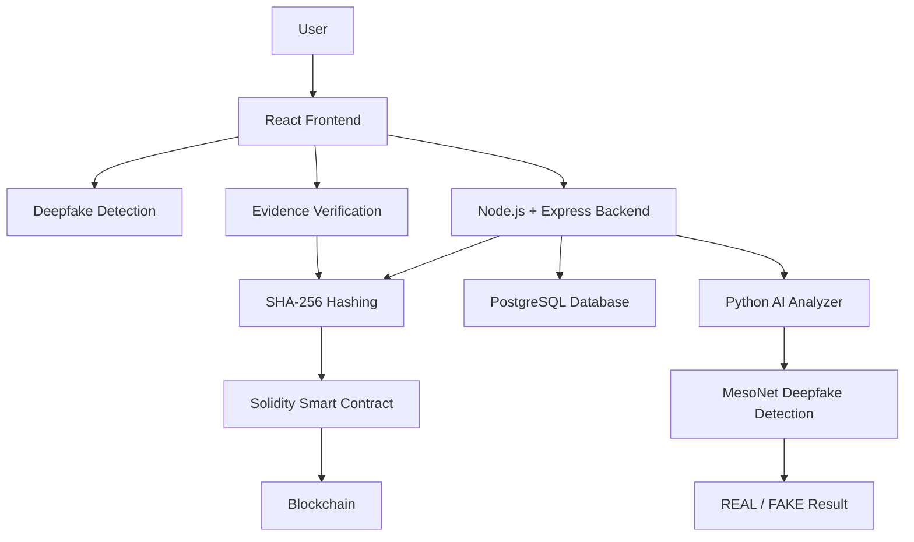

# 🛡️ Attest

### Blockchain-Based Secure Digital Evidence Platform

<p align="center">
  <strong>Making Digital Evidence Tamper-Evident, Verifiable & Trustworthy</strong>
</p>

<p align="center">
  
  
  
  
  
</p>

<p align="center">
  
</p>

<p align="center">
  🔐 Secure Evidence &nbsp; | &nbsp; 🤖 AI Deepfake Detection &nbsp; | &nbsp; ⛓️ Blockchain Integrity
</p>

---
## 🎥 Project Demo

Watch the complete demonstration of Attest:

<p align="center">
  <a href="YOUR_GOOGLE_DRIVE_LINK" target="_blank">
    
  </a>
</p>

## 📌 Overview

**Attest** is a blockchain-powered digital evidence management and verification platform that combines AI-driven deepfake detection, cryptographic hashing, and blockchain technology to ensure the integrity and traceability of digital evidence.

It provides two major capabilities:

- **Evidence Protection:** Secure evidence registration and tamper detection using SHA-256 hashing and blockchain.
- **Deepfake Detection:** AI-powered analysis of photos and videos to identify potential manipulated media.

---

## 🎯 Problem Statement

Digital evidence faces several challenges:

- Unauthorized modification and tampering.
- Deepfake videos and manipulated photographs.
- Unverifiable chain-of-custody records.
- Manual and time-consuming forensic verification.

**Attest addresses these challenges through AI-powered analysis and blockchain-backed evidence integrity.**

---

## 🚀 Key Features

### 🔐 Digital Evidence Management

- Secure video evidence upload.
- Automatic Case ID and Evidence ID generation.
- SHA-256 cryptographic hash generation.
- Blockchain-based evidence registration.
- Evidence metadata and case management.

### 🤖 AI Deepfake Detection

- **Photo & Video Deepfake Detection** — Upload any supported photo or video for AI-powered deepfake analysis.
- MesoNet-based deepfake detection.
- REAL / FAKE classification.
- Fake probability and confidence score.
- Automated video frame and face analysis.

### ⛓️ Blockchain Security

- Solidity-based smart contract.
- Immutable evidence hash records.
- Submitter and timestamp tracking.
- Blockchain transaction verification.
- Duplicate evidence registration prevention.

### ⚖️ Evidence Verification

- Verify previously registered evidence.
- Recalculate and compare SHA-256 hashes.
- Detect modified or tampered files.
- Identify unregistered evidence.

### 👤 Security & Monitoring

- JWT-based authentication.
- Secure password hashing.
- User and Admin roles.
- Evidence dashboard and activity logs.

---

## 🔄 How It Works

1. User uploads digital evidence.
2. Attest generates a unique Evidence ID and SHA-256 hash.
3. Evidence hash is registered on the blockchain.
4. Evidence metadata is stored in PostgreSQL.
5. AI analyzes media for potential deepfake manipulation.
6. During verification, the file hash is generated again.
7. The new hash is compared with the blockchain record.
8. Attest displays the integrity verification result.

**Independent Deepfake Scanner:** Users can also upload any supported photo or video for deepfake analysis without registering it as blockchain evidence.

---


## 🧱 System Architecture




---

## 🛠️ Technology Stack

| Category         | Technologies                          |
| ---------------- | ------------------------------------- |
| Frontend         | React.js, React Router, Framer Motion |
| Backend          | Node.js, Express.js                   |
| Database         | PostgreSQL                            |
| Blockchain       | Solidity, Ganache, Ethers.js          |
| AI / ML          | Python, TensorFlow, MesoNet           |
| Image Processing | OpenCV, NumPy                         |
| Security         | SHA-256, JWT, bcrypt                  |

---

## 🔌 API Endpoints

| Method | Endpoint         | Description               |
| ------ | ---------------- | ------------------------- |
| POST   | `/auth/register` | User registration         |
| POST   | `/auth/login`    | User authentication       |
| POST   | `/upload`        | Upload evidence           |
| POST   | `/verify`        | Verify evidence integrity |
| GET    | `/cases`         | Retrieve evidence cases   |
| GET    | `/records`       | Retrieve evidence records |
| GET    | `/logs`          | Retrieve audit logs       |
| GET    | `/health`        | System health check       |

---

## ⚙️ Installation & Setup

### Prerequisites

- Node.js 18+
- PostgreSQL
- Python 3.10–3.12
- Git

### 1. Clone Repository
```
git clone https://github.com/YOUR_USERNAME/Attest.git
cd Attest
```

### 2. Install Dependencies
```
npm run install:all
```

### 3. Install AI Dependencies
```
python -m venv .venv
```

Activate the virtual environment and install:
```
pip install -r deepfake/requirements.txt
```

### 4. Configure Environment

Create `backend/.env` and configure database credentials, JWT secret, blockchain RPC URL, and contract address.

Configure the frontend API URL in `frontend/.env`.

### 5. Initialize & Run
```
npm run db:init
npm run chain
npm run compile
npm run deploy
./start.sh
```

For detailed configuration and troubleshooting, refer to [SETUP.md](https://chatgpt.com/c/SETUP.md).

---

## 🌍 Real-World Applications

- Digital forensic investigations.
- Cybercrime evidence management.
- Law enforcement agencies.
- Deepfake identification.
- Video authenticity screening.
- Digital chain-of-custody verification.

---

## 🔮 Future Enhancements

- IPFS-based decentralized storage.
- Advanced deepfake detection models.
- Metadata anomaly detection.
- Enhanced forensic reporting.
- Independent verification portal.
- Multi-network blockchain support.

---

## 👥 Team AlgoFoge

**Building Attest with Blockchain, AI & Cybersecurity.**

| Team Member        | Role        |
| ------------------ | ----------- |
| Krishna Kumar      | Team Lead   |
| Muskan             | Team Member |
| Anand Kumar Dhakad | Team Member |
| Divyansh Kumar     | Team Member |

---

## ⚠️ Disclaimer

Attest assists in evidence integrity verification and AI-based authenticity screening. Blockchain registration does not independently prove that original evidence is genuine, and AI predictions are not conclusive forensic proof.

Legal admissibility remains subject to applicable laws and judicial authorities.

---

<p align="center">
  <strong>Built with ❤️ by Team AlgoFoge</strong>
</p>
