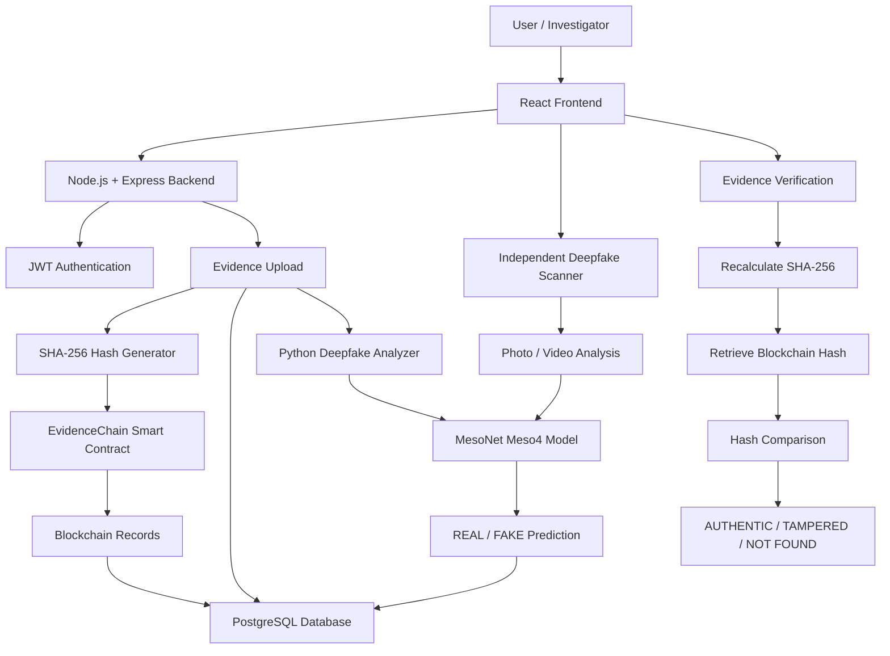

# 🛡️ Attest — Blockchain-Based Secure Digital Evidence Platform

<p align="center">
  <strong>Making Digital Evidence Tamper-Evident, Verifiable & Trustworthy</strong>
</p>

<p align="center">
  
  
  
  
  
  
</p>

<p align="center">
  🔐 Secure Evidence &nbsp; | &nbsp; 🤖 AI Deepfake Detection &nbsp; | &nbsp; ⛓️ Blockchain Integrity
</p>

---

## 📌 Overview

**Attest** is a blockchain-powered digital evidence management and verification platform that combines cryptographic hashing, AI-driven deepfake detection, and blockchain-backed records to ensure the integrity, traceability, and credibility of digital evidence.

The platform provides two major capabilities:

- **Digital Evidence Protection:** Securely register evidence, generate SHA-256 hashes, and maintain a verifiable chain of custody using blockchain.
- **Independent Deepfake Detection:** Upload any supported photo or video and analyze it using an AI-powered deepfake detection model.

Attest helps investigators verify whether digital evidence has been modified and identify potential signs of manipulated media.

**Upload → Analyze → Hash → Register → Verify → Trust.**

---

## 🎯 Problem Statement

Digital evidence is increasingly important in modern investigations. However, its reliability can be challenged by:

- Unauthorized modification of digital evidence.
- Deepfake videos and manipulated photographs.
- Broken or unverifiable chain-of-custody records.
- Difficulty proving that evidence remains unchanged.
- Manual and time-consuming authenticity verification.

Traditional systems often depend on centralized records and trust-based verification.

**Courts and investigators need verifiable proof, not just assumptions.**

---

## 💡 Our Solution

Attest combines three major technologies to strengthen digital evidence verification.

### 🔐 Cryptographic Security
- SHA-256 hash generation.
- Unique Case IDs and Evidence IDs.
- Hash comparison for tamper detection.

### 🤖 Artificial Intelligence
- AI-powered photo and video deepfake detection.
- MesoNet (Meso4) model integration.
- REAL / FAKE classification.
- Fake probability and confidence score.
- Automated video frame and face analysis.

### ⛓️ Blockchain Technology
- Immutable evidence hash registration.
- Blockchain-based evidence records.
- Submitter identification and timestamps.
- Transaction hash and block number tracking.
- Independent evidence integrity verification.

---

## 🚀 Key Features

### 🔐 Digital Evidence Management
- Secure video evidence upload.
- Automatic Case ID and Evidence ID generation.
- SHA-256 cryptographic hash generation.
- Blockchain-backed evidence registration.
- Evidence metadata management.
- Case-wise evidence organization.

### 🤖 AI Deepfake Detection
- **Photo & Video Deepfake Detection** — Upload any supported photo or video for AI-powered deepfake analysis, with REAL / FAKE prediction and confidence score.
- MesoNet (Meso4) deepfake detection model.
- Face detection and facial frame analysis.
- Video frame extraction and processing.
- Fake probability percentage.
- Automated analysis results.

### ⛓️ Blockchain Security
- Solidity-based EvidenceChain smart contract.
- Immutable evidence hash records.
- Evidence ID and Case ID mapping.
- Submitter and timestamp recording.
- Blockchain transaction tracking.
- Duplicate evidence registration prevention.

### ⚖️ Evidence Verification
- Verify previously registered evidence.
- Recalculate SHA-256 hash.
- Compare the generated hash with the blockchain record.
- Detect modified or tampered files.
- Identify unregistered evidence.

### 👤 Authentication & Access Control
- User registration and login.
- JWT-based authentication.
- Secure password hashing using bcrypt.
- User and Admin roles.
- Protected API endpoints.
- Rate-limited authentication.

### 📊 Monitoring & Audit
- Evidence records dashboard.
- Case-wise evidence tracking.
- Deepfake analysis status.
- User activity audit logs.
- Backend, database and blockchain health checks.

---

## ⭐ What Makes Attest Different?

| Feature | Attest | Traditional Systems |
|---|---|---|
| Evidence Integrity | SHA-256 verification | Often trust-based |
| Evidence Records | Blockchain-backed | Centralized |
| Deepfake Detection | AI-assisted | Often manual |
| Chain of Custody | Blockchain records | Conventional logs |
| Tamper Detection | Cryptographic comparison | Manual inspection |
| Photo & Video Analysis | AI-powered | Limited or manual |
| Verification | Independent hash lookup | Platform-dependent |

---

## 🔄 How It Works — Complete Request Flow

### Evidence Protection Workflow

1. User registers or logs into Attest.
2. User uploads a video as digital evidence.
3. Backend validates the uploaded file.
4. SHA-256 cryptographic hash is generated.
5. Evidence hash is registered through the EvidenceChain smart contract.
6. Blockchain returns transaction details and block number.
7. Evidence metadata is stored in PostgreSQL.
8. AI deepfake analysis runs in the background.
9. Analysis results are stored and displayed.
10. During verification, the file is hashed again.
11. The newly generated hash is compared with the blockchain record.
12. Attest returns the verification result.

### Independent Deepfake Detection Workflow

1. User opens the Deepfake Check feature.
2. Uploads any supported photo or video.
3. The AI pipeline processes the media.
4. Video frames are extracted where applicable.
5. Faces are detected and analyzed.
6. MesoNet evaluates the media.
7. The system generates a REAL / FAKE prediction.
8. Fake probability and confidence are displayed.

**Note:** Independent deepfake scanning does not require blockchain evidence registration.

---

## 🧠 Evidence Integrity Verification

Attest uses SHA-256 cryptographic hashing to verify whether a digital evidence file matches its original registered version.

### Hash Generation

```javascript
const crypto = require("crypto");

const hash = crypto.createHash("sha256");
```

### Verification Conditions

| Condition | Result |
|---|---|
| Computed hash = Blockchain hash | AUTHENTIC |
| Computed hash ≠ Blockchain hash | TAMPERED |
| Evidence ID not found | NOT_FOUND |

Even a small modification to a file changes its SHA-256 hash, allowing Attest to identify changes.

---

## 🤖 AI Deepfake Detection Model

Attest integrates a Python-based deepfake detection pipeline powered by **MesoNet Meso4**.

### Analysis Pipeline

1. Receive an image or video.
2. Validate the media format.
3. Extract video frames (up to 32 by default).
4. Detect faces using OpenCV Haar Cascade.
5. Crop detected faces where available.
6. Resize input to 256 × 256.
7. Run inference using the trained Meso4 model.
8. Calculate average fake probability.
9. Generate REAL / FAKE classification.
10. Return prediction confidence and analysis details.

### Model Details

| Property | Details |
|---|---|
| Architecture | MesoNet Meso4 |
| Framework | TensorFlow / Keras |
| Input | Images and Videos |
| Input Size | 256 × 256 |
| Video Frame Sampling | Up to 32 frames |
| Face Detection | OpenCV Haar Cascade |
| Output | REAL / FAKE |
| Prediction Metrics | Fake Probability & Confidence |

**Important:** AI predictions are probabilistic. They may produce false positives or false negatives and should not be considered conclusive forensic proof.

---

## 🧱 System Architecture



---

## 🛠️ Technology Stack

| Layer | Technology | Purpose |
|---|---|---|
| Frontend | React.js 19 | User interface |
| Routing | React Router | Application navigation |
| UI Animation | Framer Motion | Interface animations |
| Icons | Lucide React | UI icons |
| Backend | Node.js | Server runtime |
| API Framework | Express.js 5 | REST APIs |
| Authentication | JWT | Authentication |
| Password Security | bcryptjs | Password hashing |
| File Upload | Multer | File handling |
| Database | PostgreSQL | Evidence and user records |
| Blockchain | Solidity | Smart contracts |
| Local Blockchain | Ganache | Blockchain development |
| Blockchain Library | Ethers.js 5 | Smart contract interaction |
| Compiler | Solidity 0.8.20 | Contract compilation |
| AI Model | MesoNet Meso4 | Deepfake detection |
| AI Framework | TensorFlow 2.17 | Model inference |
| Image Processing | OpenCV | Face and frame processing |
| Numerical Processing | NumPy | Prediction processing |

---

## 📁 Project Structure

```text
Attest/
│
├── backend/
│   ├── middleware/
│   │   └── auth.js
│   │
│   ├── routes/
│   │   ├── auth.js
│   │   ├── evidence.js
│   │   └── deepfake.js
│   │
│   ├── scripts/
│   │   ├── create-admin.js
│   │   └── init-db.js
│   │
│   ├── uploads/
│   ├── audit.js
│   ├── chain.js
│   ├── config.js
│   ├── db.js
│   ├── schema.sql
│   └── server.js
│
├── contracts/
│   └── EvidenceChain.sol
│
├── deepfake/
│   ├── weights/
│   │   ├── Meso4_DF.h5
│   │   ├── Meso4_F2F.h5
│   │   ├── MesoInception_DF.h5
│   │   └── MesoInception_F2F.h5
│   │
│   ├── test_images/
│   ├── analyze.py
│   ├── classifiers.py
│   └── requirements.txt
│
├── frontend/
│   ├── public/
│   └── src/
│       ├── components/
│       ├── pages/
│       ├── AddEvidence.jsx
│       ├── VerifyEvidence.jsx
│       ├── DeepfakeCheck.jsx
│       ├── ViewEvidence.jsx
│       ├── SideBySide.jsx
│       ├── Home.jsx
│       └── App.jsx
│
├── scripts/
│   ├── compile.js
│   ├── deploy.js
│   └── test-contract.js
│
├── SETUP.md
├── start.sh
└── package.json
```

---

## 🔌 API Endpoints

### Authentication

| Method | Endpoint | Description |
|---|---|---|
| POST | `/auth/register` | Register a new user |
| POST | `/auth/login` | User authentication |
| GET | `/auth/me` | Retrieve logged-in user |

### Evidence Management

| Method | Endpoint | Description |
|---|---|---|
| POST | `/upload` | Upload and register video evidence |
| POST | `/verify` | Verify evidence integrity |
| GET | `/cases` | Retrieve evidence cases |
| GET | `/records` | Retrieve evidence records |
| GET | `/files/:evidenceId` | Access stored evidence |
| GET | `/logs` | Retrieve audit logs |

### Deepfake Analysis

| Method | Endpoint | Description |
|---|---|---|
| GET | `/deepfake/:evidenceId` | Retrieve deepfake analysis result |
| POST | `/deepfake/:evidenceId/rerun` | Re-run evidence analysis |

### System Health

| Method | Endpoint | Description |
|---|---|---|
| GET | `/health` | Check backend, database and blockchain |

**Authentication:** Protected endpoints require a JWT Bearer token.

---

## 💾 Persistent Storage

Attest uses a hybrid storage architecture.

### PostgreSQL Database

Stores:
- User information.
- Case IDs and Evidence IDs.
- Evidence metadata.
- File locations and SHA-256 hashes.
- Blockchain transaction details.
- Deepfake analysis results.
- User activity audit logs.

### Blockchain Storage

The `EvidenceChain.sol` smart contract records:
- Case ID.
- Evidence ID.
- SHA-256 evidence hash.
- Submitter ID.
- Blockchain timestamp.

### Local File Storage

Uploaded video evidence is stored locally:

```text
backend/uploads/
```

**Note:** Actual video files are stored locally, not directly on the blockchain. The blockchain stores verification-related records and hashes.

---

## ⚙️ Running Locally

### Prerequisites

- Node.js 18+ (Node.js 20 LTS recommended).
- npm.
- PostgreSQL 14+.
- Python 3.10–3.12.
- Git.

### 1. Clone Repository

```bash
git clone https://github.com/YOUR_USERNAME/Attest.git

cd Attest
```

### 2. Install Dependencies

```bash
npm run install:all
```

### 3. Create Python Environment

```bash
python -m venv .venv
```

Activate:

**Windows:**

```powershell
.venv\Scripts\activate
```

**Linux / macOS:**

```bash
source .venv/bin/activate
```

Install AI dependencies:

```bash
pip install -r deepfake/requirements.txt
```

### 4. Configure Environment Variables

Create your backend environment file:

```bash
cp backend/.env.example backend/.env
```

Configure your database credentials, JWT secret, blockchain RPC URL, and other required settings.

Example:

```env
PORT=5001

DB_HOST=localhost
DB_PORT=5432
DB_USER=postgres
DB_PASSWORD=YOUR_DATABASE_PASSWORD
DB_NAME=attest

JWT_SECRET=YOUR_SECURE_SECRET
JWT_EXPIRES_IN=8h

RPC_URL=http://127.0.0.1:8545
CONTRACT_ADDRESS=

PYTHON_BIN=python
DEEPFAKE_ENABLED=true
```

Configure the frontend environment in `frontend/.env`:

```env
REACT_APP_API_URL=http://localhost:5001
```

### 5. Initialize Database

```bash
npm run db:init
```

### 6. Start Blockchain

```bash
npm run chain
```

### 7. Compile and Deploy Smart Contract

```bash
npm run compile
npm run deploy
```

Configure the deployed contract address in your backend environment.

### 8. Start Application

```bash
./start.sh
```

Frontend:

```text
http://localhost:3000
```

Backend:

```text
http://localhost:5001
```

Backend health:

```text
http://localhost:5001/health
```

For detailed installation, configuration and troubleshooting, refer to [SETUP.md](SETUP.md).

---

## 🧪 Smart Contract Testing

Compile the smart contract:

```bash
npm run compile
```

Deploy:

```bash
npm run deploy
```

Run tests:

```bash
npm test
```

The tests cover:
- Evidence registration.
- Submitter identification.
- Evidence hash retrieval.
- Duplicate evidence rejection.
- Missing evidence handling.
- Blockchain event verification.

---

## 🌍 Real-World Applications

- Digital forensic investigations.
- Cybercrime evidence management.
- Law enforcement agencies.
- Video authenticity screening.
- Deepfake identification.
- Digital chain-of-custody management.
- Investigation case management.

---

## 🔮 Future Enhancements

- IPFS-based decentralized evidence storage.
- Advanced deepfake detection models.
- Metadata anomaly detection.
- More granular role-based access control.
- Advanced forensic reporting.
- Multi-network blockchain support.
- Independent verification portal for authorized reviewers.

---

## 👥 Team

**Team Name:** AlgoFoge

**Project Name:** Attest

**Team Lead:** Krishna Kumar

**Domain:** Blockchain × Artificial Intelligence × Cybersecurity

---

## ⚠️ Disclaimer

Attest assists in digital evidence integrity verification and AI-based authenticity screening.

Blockchain registration establishes a record of the submitted hash; it does not independently establish that the original evidence is genuine.

AI predictions are probabilistic and must not be treated as conclusive forensic proof.

Legal admissibility and evidentiary weight remain subject to applicable laws, forensic procedures, and judicial authorities.

---

## ⭐ Support

If you find Attest useful, consider giving the repository a ⭐ on GitHub!

<p align="center">
  **Built with ❤️ by Team AlgoFoge**
</p>